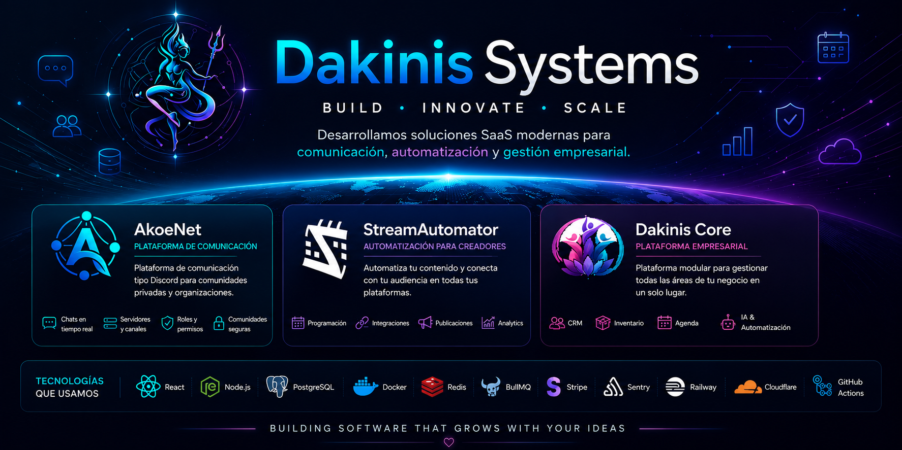

<p align="center">
  
</p>

<p align="center">
  
  &nbsp;&nbsp;&nbsp;
  
  &nbsp;&nbsp;&nbsp;
  
</p>

<div align="center">

# 🚀 Dakinis Systems

### Building modern SaaS solutions for communication, automation and business management.

[](https://github.com/dakinissystems)


> **Building software that grows with your ideas.**

</div>

---

# 🌍 About Dakinis Systems

Dakinis Systems desarrolla un ecosistema de aplicaciones SaaS orientadas a comunicación, automatización y gestión empresarial.

Nuestra arquitectura está basada en servicios independientes que comparten autenticación, infraestructura y componentes reutilizables.

---

# 🚀 Ecosistema

| Producto | Descripción |
|----------|-------------|
| 💬 **AkoeNet** | Plataforma de comunicación para comunidades |
| 📅 **StreamAutomator** | Automatización para streamers y creadores |
| 🏢 **Dakinis Core** | Plataforma modular de gestión empresarial |

---

# 💬 AkoeNet

Una plataforma moderna inspirada en Discord para comunidades privadas.

### Características

- Chats en tiempo real
- Servidores y canales
- Roles y permisos
- Administración de comunidades
- Arquitectura escalable

---

# 📅 StreamAutomator

Automatiza la gestión del contenido para streamers.

### Funciones

- Programación de publicaciones
- Twitch
- Discord
- Redes Sociales
- Analytics

---

# 🏢 Dakinis Core

ERP modular desarrollado sobre Dakinis Platform.

### Incluye

- CRM
- Agenda
- Inventario
- Restaurante
- Reservas
- WhatsApp
- Facturación
- Inteligencia Artificial

---

# 🏗 Arquitectura

```text
                           Dakinis Systems
                                  │
      ┌───────────────────────────┼───────────────────────────┐
      │                           │                           │
   AkoeNet                StreamAutomator             Dakinis Core
      │                           │                           │
      └────────────── Shared Services ─────────────────────────┘
                              │
       Authentication • Billing • Notifications • Storage
```

---

# ⚙️ Stack Tecnológico

### Frontend

- React
- Vite
- Bootstrap
- Capacitor

### Backend

- Node.js
- Express

### Bases de Datos

- PostgreSQL
- SQLite

### Infraestructura

- Docker
- Railway
- Cloudflare

### Servicios

- Redis
- BullMQ
- Stripe
- Sentry

---

# 📦 Repositorios

| Repositorio | Función |
|-------------|---------|
| `akoenet-client` | Frontend AkoeNet |
| `akoenet-backend` | Backend AkoeNet |
| `streamautomator` | Plataforma de automatización |
| `dakinis-core` | Plataforma principal |
| `dakinis-auth` | Servicio de autenticación |
| `dakinis-shared` | Librerías compartidas |

---

# 🎯 Filosofía

Creemos que el software debe ser:

- 🚀 Escalable
- 🔒 Seguro
- ⚡ Rápido
- ❤️ Fácil de usar
- 🧩 Modular
- 🛠 Fácil de mantener

---

# 🛣 Roadmap

- ✅ Arquitectura Modular
- ✅ Autenticación Centralizada
- ✅ Shared Libraries
- 🚧 Multi-Tenant Platform
- 🚧 AI Services
- 🚧 Marketplace
- 🚧 Public API
- 📱 Mobile Apps

---

# 🤝 Contribuir

Actualmente nuestros proyectos están en desarrollo activo.

Próximamente publicaremos componentes y librerías Open Source.

---

<div align="center">

## 🌐 Organización

https://github.com/dakinissystems

---

### Building • Innovate • Scale

**Made with ❤️ by Dakinis Systems**

</div>
